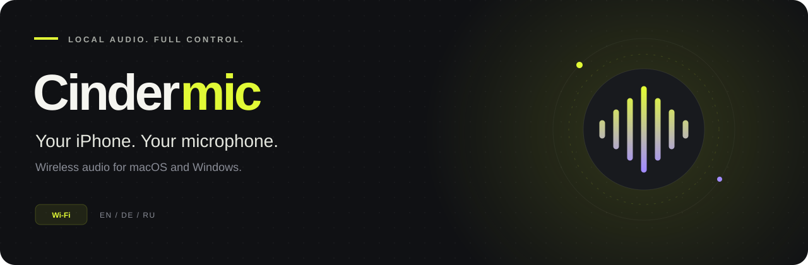
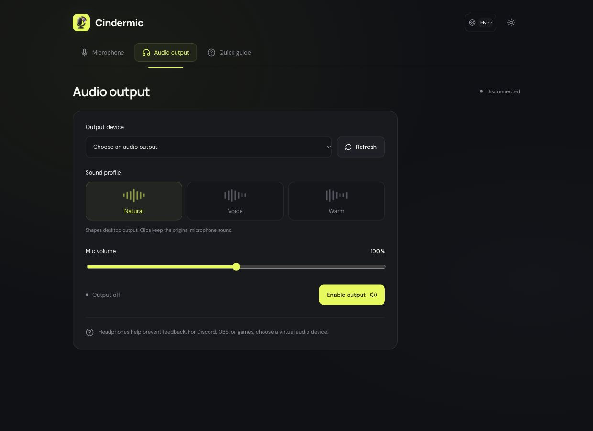

<div align="center">



**Turn your iPhone into a wireless microphone for your computer.**

[](https://github.com/t1mchh/Cindermic/releases)
[](https://github.com/t1mchh/Cindermic/actions/workflows/build.yml)
[](#download)
[](#features)

[Download](#download) · [Get connected](#get-connected) · [Build it yourself](#build-it-yourself) · [Русский](docs/README.ru.md) · [Deutsch](docs/README.de.md)

</div>

## Download

**Desktop v0.3.2** — the desktop app includes its local audio receiver. No Node.js installation is needed to use the downloads.

| Platform                             | Download                                                                                                                   |
| ------------------------------------ | -------------------------------------------------------------------------------------------------------------------------- |
| macOS · Apple Silicon (M1 and newer) | [Download Mac ARM64 ZIP](https://github.com/t1mchh/Cindermic/releases/download/v0.3.2/Cindermic-0.3.2-mac-arm64.zip)       |
| macOS · Intel                        | [Download Mac Intel ZIP](https://github.com/t1mchh/Cindermic/releases/download/v0.3.2/Cindermic-0.3.2-mac-x64.zip)         |
| Windows · x64                        | [Download Windows installer](https://github.com/t1mchh/Cindermic/releases/download/v0.3.2/Cindermic-0.3.2-windows-x64.exe) |
| Windows · x64 portable               | [Download Windows ZIP](https://github.com/t1mchh/Cindermic/releases/download/v0.3.2/Cindermic-0.3.2-windows-x64.zip)       |

[All releases, notes, and SHA-256 checksums →](https://github.com/t1mchh/Cindermic/releases)

The iPhone companion is built and installed with Xcode; it is not on the App Store. See [iPhone setup](#iphone-companion).

**Installation:** on Mac, extract the ZIP and move `Cindermic.app` to Applications. On Windows, run the installer, or extract the portable ZIP and launch `Cindermic.exe`. Personal-release builds are not notarized for macOS or signed with a Windows publisher certificate, so your OS may show a verification warning.

## Features

- **Pair in seconds** — scan the desktop QR code on your iPhone, or paste the pairing link.
- **Local Wi-Fi audio** — direct device connection, encrypted phone transport, and no cloud account.
- **Mute from either device** — synchronized controls and an `M` keyboard shortcut on desktop.
- **Automatic reconnect** — recover after temporary network loss while preserving mute.
- **Live visuals** — real microphone level, waveform, reactive halo, and reduced-motion support.
- **Sound profiles** — Natural, Voice, and Warm equalization for desktop output.
- **Quick clips** — record the original microphone to a local WAV, up to two minutes.
- **Make it yours** — dark/light themes and English, German, and Russian interfaces.

<div align="center">

</div>

## Get connected

1. Open Cindermic on your computer and keep its QR code visible.
2. Connect your iPhone and computer to the **same Wi-Fi network**.
3. Open the iPhone app, tap **Scan QR code**, and allow camera, microphone, and local-network access.
4. Scan the desktop code and speak. The computer's meter should react to your voice.
5. To listen, choose headphones in **Audio output**, then enable output. To record, use **Quick clip → Record clip → Stop recording → Save WAV**.

If pairing times out, check that the desktop app is open and that the firewall permits local-network access to its audio receiver on TCP **43129**. If the desktop's IP changes, scan its new QR code. The manual fallback uses the complete pairing link, which contains the address and the device credentials; keep it private.

### Discord, OBS, and games

Receiving audio in Cindermic is separate from appearing as a system microphone. Use a separately installed virtual audio device to route its output into another app. For example, with VB-CABLE on Windows, send Cindermic output to **CABLE Input** and select **CABLE Output** as the target app's microphone.

### iPhone companion

Requires a Mac with Xcode and an iPhone running iOS 17 or newer. From the source checkout:

```sh
npm ci
npm run ios
```

In Xcode, select the **App** scheme, your iPhone, and your development team under **Signing & Capabilities**, then press **Run**. Enable Developer Mode and trust your developer profile if iOS requests it. The interface is shared with desktop; native Swift handles microphone capture and the QR camera.

Basic iPhone operation has been reported working by the project owner. Screen-lock endurance, Wi-Fi roaming, and recovery from another app taking the microphone still need systematic device testing. iOS may interrupt recording when another app uses its microphone.

## Build it yourself

Requires **Node.js 24+** and npm.

```sh
git clone https://github.com/t1mchh/Cindermic.git
cd Cindermic
npm ci
npm run dev
```

Open [localhost:3000](http://localhost:3000). For a desktop window, use `npm run desktop`.

| Command                | Purpose                                                                |
| ---------------------- | ---------------------------------------------------------------------- |
| `npm run check`        | TypeScript checks                                                      |
| `npm test`             | Unit and integration tests                                             |
| `npm run test:audio`   | Synthetic microphone, playback, mute, reconnect, and WAV download test |
| `npm run dist:mac`     | Build and verify a Mac ZIP on macOS                                    |
| `npm run dist:win`     | Build the Windows installer on Windows                                 |
| `npm run dist:win:zip` | Build a portable Windows ZIP                                           |
| `npm run ios`          | Export the interface, sync the native plugin, and open Xcode           |
| `npm run ios:build`    | Compile the iPhone app without signing or installing it                |

Tagging a version (`v*`) runs native desktop builds in GitHub Actions and publishes the downloads after every build succeeds. Build products belong in Releases, not in the source tree. Local pairing identities, private certificates, and generated projects are Git-ignored.

## Under the hood

**Next.js + React** interface · **Electron** desktop · **Node.js + TLS WebSocket** receiver · **Capacitor + Swift** iPhone companion.

Audio is mono PCM16 at 48 kHz. Capture and playback queues are bounded; connection setup has timeouts. The waveform reflects real received audio. Sound profiles affect desktop output; WAV clips retain the original mic signal. No subscription, account, cloud relay, or telemetry is required.

[Architecture](docs/architecture.md) · [Development guide](docs/development.md) · [Testing](docs/testing.md) · [Contributing](CONTRIBUTING.md) · [Audit](AUDIT.md)

## Scope

This is an early personal project. Wi-Fi is implemented; Android, Bluetooth, Wi-Fi Direct, USB, and a bundled virtual microphone driver are not. Builds and automated checks do not substitute for testing audio hardware and OS permissions on every platform. Source is published without an open-source license grant (`UNLICENSED`).
