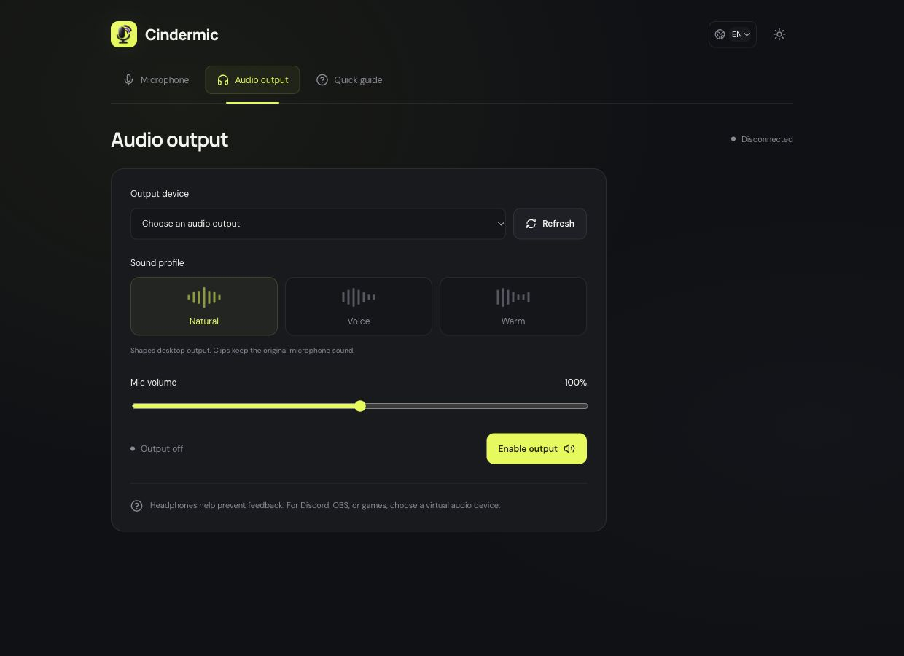

# Cindermic

**Dein iPhone als WLAN-Mikrofon für Mac und Windows.** Direkte Verbindung im lokalen Netzwerk, ohne Konto oder Cloud-Relay.

[English](../README.md) · [Русский](README.ru.md) · [Downloads](https://github.com/t1mchh/Cindermic/releases/latest)



## Downloads

| Computer            | Version 0.3.3                                                                                                                                                                                                                |
| ------------------- | ---------------------------------------------------------------------------------------------------------------------------------------------------------------------------------------------------------------------------- |
| Mac · Apple Silicon | [ARM64 ZIP](https://github.com/t1mchh/Cindermic/releases/download/v0.3.3/Cindermic-0.3.3-mac-arm64.zip)                                                                                                                      |
| Mac · Intel         | [x64 ZIP](https://github.com/t1mchh/Cindermic/releases/download/v0.3.3/Cindermic-0.3.3-mac-x64.zip)                                                                                                                          |
| Windows · x64       | [EXE-Installer](https://github.com/t1mchh/Cindermic/releases/download/v0.3.3/Cindermic-0.3.3-windows-x64.exe) · [Portable ZIP](https://github.com/t1mchh/Cindermic/releases/download/v0.3.3/Cindermic-0.3.3-windows-x64.zip) |

Für die Downloads ist keine Node.js-Installation erforderlich. Auf dem Mac das Archiv entpacken und Cindermic.app nach Applications verschieben. Unter Windows den Installer ausführen oder das portable Archiv entpacken und Cindermic.exe starten. Die persönlichen Builds sind auf macOS nicht notarisiert und haben unter Windows kein Herausgeberzertifikat; das Betriebssystem kann einen Prüfhinweis anzeigen.

## iPhone verbinden

1. Cindermic auf dem Computer öffnen und den QR-Code anzeigen lassen.
2. iPhone und Computer mit demselben WLAN verbinden.
3. Auf dem iPhone **QR-Code scannen** wählen und den Desktop-Code scannen.
4. Kamera, Mikrofon und lokalen Netzwerkzugriff erlauben. Der Pegel sollte auf deine Stimme reagieren.
5. Unter **Audioausgabe** Kopfhörer wählen und die Ausgabe starten. **M** schaltet das verbundene Mikrofon stumm bzw. wieder ein.

**Kurzaufnahme** speichert bis zu zwei Minuten als lokale WAV-Datei. Vor dem Speichern bleibt die Aufnahme nur im Arbeitsspeicher. Die Profile Natürlich, Stimme und Warm ändern die Desktop-Ausgabe; Aufnahmen behalten das ursprüngliche Mikrofonsignal.

Die iPhone-App wird mit Xcode installiert. Benötigt werden ein Mac mit Xcode und iOS 17 oder neuer:

```sh
git clone https://github.com/t1mchh/Cindermic.git
cd Cindermic
npm ci
npm run ios
```

In Xcode das Schema App, dein iPhone und dein Team unter Signing & Capabilities wählen, dann Run drücken. Bei Verbindungsproblemen WLAN und Firewall-Freigabe für TCP-Port 43129 prüfen. Nach einer Änderung der Desktop-IP erneut scannen. Die manuelle Verbindung benötigt den vollständigen privaten Kopplungslink einschließlich Gerätekennung; eine IP-Adresse allein reicht nicht.

## Umfang

Für Discord, OBS und Spiele wird ein separat installiertes virtuelles Audiogerät benötigt. Cindermic installiert keinen Mikrofontreiber. Andere iPhone-Apps können die Mikrofonaufnahme unterbrechen. Lange Sperrbildschirm-Sitzungen, WLAN-Wechsel und Unterbrechungen benötigen zusätzliche Gerätetests. Bluetooth, Wi-Fi Direct, USB und Android werden nicht unterstützt.

[Entwicklung](development.md) · [Architektur](architecture.md) · [Tests](testing.md)
