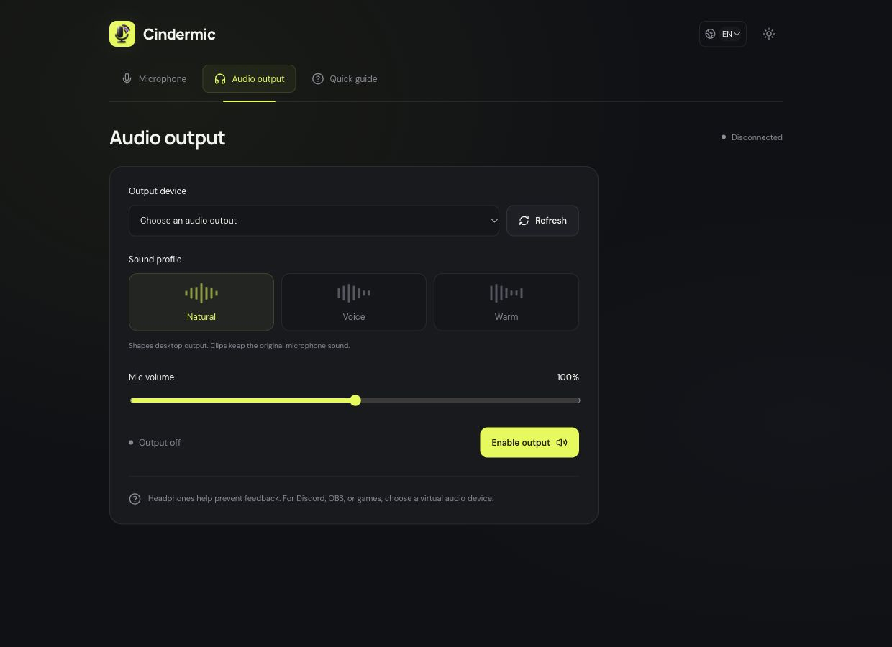

# Cindermic

**iPhone как беспроводной микрофон для Mac и Windows.** Подключение по локальной Wi-Fi сети, без аккаунта и облачного сервера.

[English](../README.md) · [Deutsch](README.de.md) · [Скачать сборки](https://github.com/t1mchh/Cindermic/releases/latest)



## Скачать

| Компьютер           | Сборка v0.3.0                                                                                                                                                                                                                 |
| ------------------- | ----------------------------------------------------------------------------------------------------------------------------------------------------------------------------------------------------------------------------- |
| Mac · Apple Silicon | [ZIP ARM64](https://github.com/t1mchh/Cindermic/releases/download/v0.3.0/Cindermic-0.3.0-mac-arm64.zip)                                                                                                                       |
| Mac · Intel         | [ZIP x64](https://github.com/t1mchh/Cindermic/releases/download/v0.3.0/Cindermic-0.3.0-mac-x64.zip)                                                                                                                           |
| Windows · x64       | [Установщик EXE](https://github.com/t1mchh/Cindermic/releases/download/v0.3.0/Cindermic-0.3.0-windows-x64.exe) · [Portable ZIP](https://github.com/t1mchh/Cindermic/releases/download/v0.3.0/Cindermic-0.3.0-windows-x64.zip) |

Для готовых сборок Node.js не нужен. На Mac распакуй архив и перенеси приложение в Applications. На Windows запусти установщик либо распакуй portable-версию и открой Cindermic.exe. Сборки предназначены для личного использования: Mac-приложение не нотарифицировано, а Windows-приложение не подписано сертификатом издателя. Система может показать предупреждение о проверке разработчика.

## Подключить iPhone

1. Открой Cindermic на компьютере.
2. Подключи компьютер и iPhone к одной Wi-Fi сети.
3. В приложении на iPhone нажми **Сканировать QR-код** и сканируй код на компьютере.
4. Разреши камеру, микрофон и локальную сеть. Проверь, что шкала реагирует на голос.
5. Выбери наушники в разделе **Аудиовыход** и включи вывод. Клавиша **M** на компьютере выключает и включает микрофон.

Для записи используй **Быстрая запись → Записать → Остановить запись → Сохранить WAV**. Лимит — две минуты; до сохранения запись хранится только в памяти. Профили «Чистый / Голос / Тёплый» меняют вывод на компьютере, сохраняя оригинальный звук в записи.

Приложение iPhone устанавливается через Xcode, не через App Store. Нужны Mac с Xcode и iOS 17 или новее:

```sh
git clone https://github.com/t1mchh/Cindermic.git
cd Cindermic
npm ci
npm run ios
```

Выбери схему App, свой iPhone и команду разработчика в Signing & Capabilities, затем нажми Run. Если соединение не проходит, проверь Wi-Fi и разрешение брандмауэра для локального TCP-порта 43129. При смене IP компьютера сканируй новый QR-код. Для ручного подключения нужен полный pairing link, а не один IP-адрес; не публикуй эту ссылку.

## Ограничения

Для Discord, OBS и игр нужен отдельный виртуальный аудиокабель: Cindermic не устанавливает драйвер микрофона. Другие приложения iPhone могут прерывать захват микрофона. Длительная работа при блокировке, смена Wi-Fi и восстановление после прерываний требуют дополнительных проверок на устройствах. Bluetooth, Wi-Fi Direct, USB и Android пока не поддерживаются.

[Разработка](development.md) · [Архитектура](architecture.md) · [Тестирование](testing.md)
